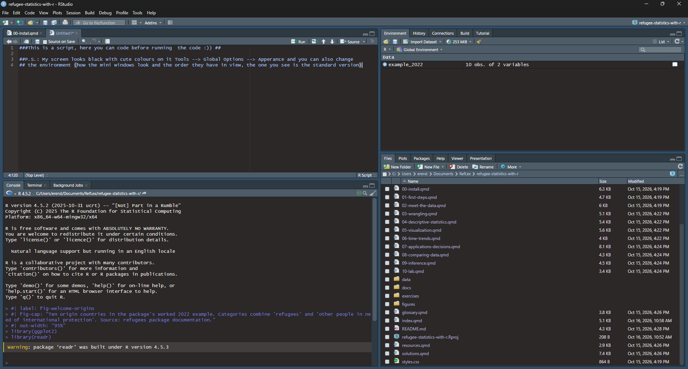

::: {.callout-note title="Learning goals"}
Understand what R and RStudio each do; install them; navigate RStudio; distinguish installing from loading a package; create a script and a project; troubleshoot a common error.
:::

## What are we actually installing?

**R** is the language and computational engine. It understands instructions such as `2 + 2`, calculates statistics, and creates plots. **RStudio** is an environment in which it is easier to write, save, and run those instructions. **Packages** are collections of additional functions and, sometimes, datasets. **Quarto** is the publishing tool used to turn lessons like these into web pages, PDFs, or books. You do *not* need to install Quarto just to complete the exercises.

Think of this separation as: R is the engine; RStudio is the dashboard; a package is a set of tools; and a script records what you did so somebody else can repeat it.

| Name | What it does | Install once? |
|---|---|---|
| R | Runs your commands and calculations | Yes, update periodically |
| RStudio Desktop | Editor, console, plots, files | Yes, update periodically |
| `refugees` | UNHCR displacement datasets in R | Install once per R installation; update when needed |
| `dplyr` | Filter, arrange, transform and summarize data | Install once per R installation |
| `ggplot2` | Create graphs | Install once per R installation |
| `readr` | Read CSV files | Install once per R installation |

## Install R (first)

1. Open <https://cran.r-project.org/>.
2. Choose your operating system (Windows, macOS, or Linux).
3. Select the standard/base installation for your operating system and follow the installer instructions.
4. Close and reopen RStudio if it was already running.

**Windows:** use the CRAN Windows base download. **Mac:** download the installer compatible with your macOS version and processor. **Linux:** follow your distribution's CRAN instructions. Use the official websites rather than random download mirrors.

## Install RStudio Desktop (second)

1. Open <https://posit.co/download/rstudio-desktop/>.
2. Download the free RStudio Desktop application appropriate for your system.
3. Launch RStudio. RStudio should detect your installed version of R.

When you first open RStudio, you will see an interface similar
to @fig-rstudio-interface. The screen is divided into four main
panels, each serving a different purpose.

{#fig-rstudio-interface width="100%" fig-align="center"}

| Pane | What you see | Why it matters |
|---|---|---|
| **Console** | A prompt starting with `>` | Execute commands immediately |
| **Source** | An editor for `.R` or `.qmd` files | Keep code you can save and rerun |
| **Environment / History** | Objects currently in memory | Check what your script created |
| **Files / Plots / Packages / Help** | Data files, graphs, package lists and help | Inspect results and get assistance |

## Run your first command

In the Console, type this and press Enter:

```{r}
2 + 2
```

Expected result: `[1] 4`. The `[1]` tells you the position of the first printed element; it is *not* part of the arithmetic answer. Now try `7 * 8`, `12 / 3`, and `2^3`.

## Create a project and a script

The **Console** is good for trying something quickly. But a collection of commands typed into the Console is difficult to reconstruct later. Research should normally happen in **scripts**: files that preserve the commands used in an analysis.

### What is an R script?

An R script is a text file containing R commands, usually saved with the extension `.R`. Instead of entering every instruction directly into the Console, we save the commands in a script and can run them again whenever needed.

This is particularly useful for research. Imagine that you calculate refugee recognition rates, exclude some observations, and produce a graph. Six months later, a colleague asks how you obtained your results. If you saved your commands in a script, you can show exactly what you did instead of trying to reconstruct it from memory.

### What is an R project?

An **R project** helps organize the files belonging to the same analysis: scripts, datasets, figures, and results. For example, a project might eventually contain:

```text
refugee-r-practice/
├── data/
├── scripts/
├── figures/
└── refugee-r-practice.Rproj
```

Why a project? It makes paths predictable. If your project contains `data/my-file.csv`, your code can refer to `"data/my-file.csv"` rather than to somebody's personal desktop location.

### Create your first project and script

1. In RStudio, choose **File → New Project → New Directory → New Project**.
2. Name it something like `refugee-r-practice`. Choose an easy location and click **Create Project**.
3. Choose **File → New File → R Script** and save the file as `my-first-analysis.R`.
4. Type the commands below in the script and use **Ctrl+Enter** (Windows/Linux) or **Cmd+Enter** (macOS) to run the line under your cursor.

```{r}
#| eval: false

# My first R script
# Practising basic calculations

2 + 2
sqrt(25)
```

Lines beginning with `#` are **comments**. R ignores them when running the commands. Comments help us explain what our code does, especially when another researcher needs to read it later.

### Why reproducibility matters

One of the main reasons researchers use R is **reproducibility**. A script makes it easier to repeat calculations and verify the steps that produced a result. But having a script is not enough on its own: we also need to document our data sources, definitions, analytical decisions, and relevant software versions.

::: {.callout-tip title="Why does this matter for the project?"}
Using R scripts makes it easier to:

- Document how each indicator was constructed.
- Identify which observations were included or excluded.
- Check and correct mistakes.
- Update analyses when new data become available.
- Allow colleagues to verify and reproduce findings.

**A reproducible analysis is not simply one that produces a result: it makes the steps leading to that result transparent and traceable.**
:::

Packages and data can change over time. One useful command to keep in mind is `sessionInfo()`, which reports your R version and information about your current R session. We will return to software versions and reproducibility in later chapters.


## Managing your RStudio session: good practices

Before we start working with real datasets, it is useful to learn a few habits that will make your experience with R easier and your analyses more reproducible.

When working in RStudio, we need to distinguish between **the code we write, the objects R holds in memory, and the files we save on our computer**.

### Saving your work

When you create an R script, your commands appear in the **Source** panel of RStudio.

However, writing code does not automatically save it to your computer!

To save your script:

1. Click **File → Save**, or press **Ctrl + S** (Windows/Linux) or **Cmd + S** (macOS).
2. Give your file a descriptive name, such as `refugee_analysis.R`.
3. Save it inside your RStudio project.

You should save your work regularly, particularly before executing long scripts or making substantial changes.

::: {.callout-important title="Saving a script is not the same as saving your results"}

**Saving a script** preserves the commands you wrote.

**Running a script** creates objects and results in R's memory.

If you close RStudio, objects in memory may disappear. However, your saved script remains available, and you can run it again to recreate them.

This is one reason reproducible scripts are so useful: we do not need to preserve every temporary object if we can recreate it from the code.
:::

### Understanding the Environment

Look at the **Environment** panel, usually in the upper-right corner of RStudio.

This panel displays objects currently stored in R's memory.

For example, run the following command in the Console:

```{r}
applications <- c(12, 18, 9, 25, 16)
```

You should now see an object called `applications` in the Environment panel.

You can also list the objects currently available in your session:

```{r}
ls()
```

The function `ls()` stands for *list objects*. It returns the names of objects in your current environment.

Remember that these objects are not necessarily saved as files on your computer.

### Removing objects from the Environment

As we work with datasets, the Environment can become crowded with objects that we no longer need.

There are several ways to remove them.

**Option 1: Remove a specific object**

Use `rm()` (short for *remove*):

```{r}
#| eval: false

rm(applications)
```

This removes the object called `applications` from the current environment.

**Option 2: Clear the entire Environment**

You can remove all objects from the global environment using:

```{r}
#| eval: false

rm(list = ls())
```

Let's understand this command:

- `ls()` produces a list of object names.
- `rm()` removes objects.
- `list = ls()` tells R which objects to remove.

Alternatively, you can click the **broom icon** in RStudio's Environment panel and confirm that you want to clear the objects.

::: {.callout-warning title="Be careful when clearing the Environment"}

Removing objects from the Environment does not delete your saved scripts or data files.

However, it does remove objects currently stored in memory. If you created something interactively without saving the commands needed to reproduce it, you may lose that work.

For ordinary analysis scripts, there is generally no need to begin with `rm(list = ls())`. A better habit is to write code that runs correctly from a fresh R session.
:::

### Clearing the Console versus restarting R

Two other operations are useful, but they do different things.

**Clearing the Console**

Sometimes the Console becomes crowded with commands and printed results.

Press **Ctrl + L** to clear the visible Console.

This makes the Console easier to read, but **does not remove objects from the Environment**.

**Restarting R**

To restart the R session, select:

**Session → Restart R**

Restarting R clears the current session's objects and unloads packages that were loaded during that session.

This provides a fresh working environment without requiring you to close your RStudio project.

### Why should we sometimes restart R?

Imagine that you have been working for several hours and created many objects.

Your script may appear to work correctly because some of these objects are still available in memory, even though the commands that created them are missing from the script.

If you send that script to a colleague, it may fail because those objects do not exist on their computer.

A useful way to check your work is therefore to:

1. Save your script.
2. Restart R using **Session → Restart R**.
3. Run your script from the beginning.
4. Check whether it produces the expected results without requiring additional commands.

If it works, you have taken an important step toward making your analysis reproducible.

::: {.callout-tip title="A good practice: start with a clean session"}

Try not to rely on objects left over from previous analyses.

A good script should contain the commands necessary to load its packages, access its data, perform its calculations, and generate its results.

You should be able to restart R and execute the script again without having to remember what you did yesterday.
:::

### Should you save your R workspace?

When closing RStudio, you may be asked whether you want to save your workspace.

Saving the workspace stores objects from your R session in a file, commonly called `.RData`, so they can be restored later.

While this can be convenient, it can also create confusion: objects may appear in your Environment even though you have not created them during the current session.

**For this course, we recommend relying on saved scripts rather than automatically restoring previous workspaces.**

You can configure this in RStudio under:

**Tools → Global Options → General**

Look for the workspace settings and:

- Set **Save workspace to .RData on exit** to **Never**.
- Disable **Restore .RData into workspace at startup**.

Depending on your RStudio version, these options may appear in a slightly different location.

This helps ensure that each new session begins without unexpected objects from previous work.

### What if we actually need to save a dataset?

Sometimes we create a cleaned or transformed dataset that we want to reuse later without repeating every calculation.

R provides functions for saving objects as files.

For example:

```{r}
#| eval: false

# Save an R object to a file
saveRDS(applications, "applications.rds")

# Read the saved object again
applications <- readRDS("applications.rds")
```

The `.rds` format preserves an R object, including its structure.

We will also learn how to save tables as CSV files and export graphs in later sections.

For now, remember that **saving code and saving data are two different operations**. Ideally, we keep both the code used to generate our results and any necessary data files organized within the same project.

### Good habits to develop from the beginning

| Good practice | Why it matters |
|---|---|
| Save your `.R` scripts regularly | Avoid losing code |
| Use descriptive names for objects and files | Make analyses easier to understand |
| Write comments with `#` | Explain what your code does |
| Work inside an RStudio project | Keep scripts, datasets, and results organized |
| Avoid relying on old objects in memory | Reduce hidden dependencies |
| Restart R and rerun scripts occasionally | Check reproducibility |
| Keep original data files unchanged | Preserve the source data |
| Avoid automatically restoring `.RData` | Start with a predictable environment |

::: {.callout-note title="A small exercise"}

Try the following:

1. Create an object called `test` containing the numbers 1, 2, 3, 4, and 5.
2. Find it in the Environment panel.
3. Use `ls()` to list the available objects.
4. Clear the Console using **Ctrl + L**. Is `test` still in the Environment?
5. Remove the object using `rm(test)`.
6. Create it again, this time writing the command in your saved R script.
7. Restart R and execute the script. Does the object reappear?

**The key lesson:** a script records how to create an object; the Environment holds objects created during your current R session.

:::


## Install and use R packages

We have seen how to write and save commands in R. But what if we want to work with specialized datasets, manipulate tables efficiently, or produce more sophisticated graphs? R already provides useful functions, but we can extend its capabilities through **packages**.

### What are R packages?

One of R's greatest strengths is its **open-source community**. R is free and open-source software. Its development and wider ecosystem benefit from contributions by statisticians, computer scientists, academic researchers, research institutions, and software developers around the world.

Importantly, users are not limited to the functions included in a standard R installation. Other people can develop tools and share them with the R community. These collections of additional tools are called **packages**.

A package typically contains functions, documentation, and sometimes datasets.

Think of R as a toolbox. When you install R, you already receive many essential tools. Installing packages allows you to add more tools designed for particular tasks.

For example:

| Package | What does it do? | How will we use it? |
|---|---|---|
| `refugees` | Provides UNHCR population and asylum statistics | Explore refugee populations, applications, and decisions |
| `dplyr` | Provides tools for manipulating data | Filter, select, group, and summarize observations |
| `ggplot2` | Creates statistical graphics | Produce bar charts, histograms, scatterplots, and time-series plots...and maps! |
| `readr` | Imports and exports data | Read CSV files |
| `tidyr` | Reshapes and organizes data | Reorganize datasets into formats suitable for analysis |
| `scales` | Formats numbers and graphical scales | Display readable numbers, percentages, and axis labels |

**Why is this useful?**

Imagine that we want to compare refugee populations across European countries, calculate yearly changes in asylum applications, or visualize differences in recognition rates.

We could perform many of these operations using base R. However, packages such as `dplyr` and `ggplot2` make them easier to write, read, and reproduce.

Rather than programming every operation from scratch, we can use functions that others have already developed, documented, and shared.

::: {.callout-tip}
## Packages and collaborative research

The development of R packages is an example of how scientific and open-source communities share tools. Many packages are maintained by researchers and developers who make their code publicly available. Others can inspect the code, report problems, propose improvements, or contribute new features.

This does not mean that all packages are collectively developed or automatically reliable. Their quality, maintenance, and documentation can vary. When choosing a package for research, we should consider who developed it, whether it is maintained, what methods it implements, and whether its results have been validated.
:::

### Where do packages come from?

A major source of R packages is the **[Comprehensive R Archive Network (CRAN)](https://cran.r-project.org/)**:

CRAN is a network of servers that distributes R and thousands of contributed packages. Packages submitted to CRAN must satisfy technical requirements and undergo automated checks. However, passing these checks does not necessarily mean that every statistical method implemented by a package has been scientifically validated.

Packages can also be distributed through other repositories, including GitHub, although for this course we will primarily use packages available through CRAN.

### Installing versus loading packages

There are two important operations to distinguish:

**1. Installing a package**

Installing means downloading a package and saving it in your computer's R package library.

We use the function:

`install.packages("package_name")`

For example, `install.packages("ggplot2")` installs the `ggplot2` package.

You generally install a package only once. You may need to reinstall or update it when changing computers, reinstalling R, or requiring a different package version.

**2. Loading a package**

Once a package is installed, we need to load it into the current R session to make its functions directly available.

We use the function:

`library(package_name)`

For example, `library(ggplot2)` makes the functions in `ggplot2` available for the current session.

Loading must be repeated when starting a new R session if we want to use the package's functions directly.

::: {.callout-important}
## Remember the difference

**`install.packages()`** downloads and installs a package on your computer.

**`library()`** loads an already installed package into the current R session.

Think of installing as adding a new tool to your toolbox, and loading as taking that tool out when you need it.
:::

### Install the packages for this course

Run the following **once** in the RStudio Console when setting up R, or when you need to reinstall the packages.

Installing downloads software from CRAN to your computer; it is **not** something to repeat at the start of every script.

```{r}
#| eval: false

install.packages(c(
  "refugees",
  "dplyr",
  "ggplot2",
  "readr",
  "tidyr",
  "scales"
))
```

Notice that we use `c()` to combine several package names into a single vector. This allows us to install all six packages with one command.

Installation may take a few minutes. R may also install other packages automatically. These are called **dependencies**: packages required by the packages we want to use.

### Load your packages

Now **load** the packages at the beginning of a new R session:

```{r}
library(refugees)
library(dplyr)
library(ggplot2)
```

We only need to load the packages required for our current analysis. Later, when we need other packages, we can load them as well.

A useful habit is to put all the `library()` commands at the beginning of a script. This helps other researchers understand which packages are needed to reproduce our work.

### Let's try it: exploring the UNHCR data

We are now ready to use our first real dataset. The `refugees` package contains data on refugee populations and asylum processes.

Run:

```{r}
head(refugees::population[, c(
  "year",
  "coo_name",
  "coa_name",
  "refugees"
)])
```

The function `head()` displays the first six rows of a dataset.

Inside the square brackets, we select four variables:

- `year`: reference year.
- `coo_name`: country of origin.
- `coa_name`: country of asylum.
- `refugees`: number of refugees in the corresponding observation.

The `::` notation tells R **which package owns a function or dataset**.

For example, `refugees::population` works even if we did not previously run `library(refugees)`.

This can be particularly useful when different packages contain functions with the same name.

::: {.callout-note}
## What have we just done?

We have accessed real UNHCR statistics directly through R, selected four variables, and displayed the first six observations. As we progress, we will learn to filter these data, calculate descriptive statistics, compare countries, and produce graphs.
:::

## Getting help and handling errors

R errors are a normal part of learning to program. Even experienced researchers encounter errors regularly.

The important thing is to **read the error message carefully**, understand what R is telling us, and identify the likely cause rather than immediately trying a random new command.

### Finding help in R

R includes documentation explaining how functions and packages work.

For example:

```{r}
#| eval: false

?mean
help(package = "refugees")
```

The first command opens the documentation for the `mean()` function.

The second opens information about the `refugees` package.

You can also search for help using:

```{r}
#| eval: false

help.search("regression")
```

### Common errors and how to solve them

| Message | Likely cause | A first fix |
|---|---|---|
| `could not find function "filter"` | `dplyr` not loaded | Run `library(dplyr)` |
| `there is no package called 'refugees'` | Package not installed in the current R library | Run `install.packages("refugees")` |
| `object 'hosts' not found` | Earlier line creating `hosts` was not run, or contains a typo | Run the script from the top |
| `unexpected symbol` | Often a missing comma, quote, or bracket | Examine the line immediately before the error |
| `+` instead of `>` in the Console | R is waiting for the rest of an incomplete expression | Complete it or press Esc |

::: {.callout-note}
## A warning is not necessarily an error

Sometimes R displays a **warning** rather than an error. For example, it may tell you that a package was built under a slightly different version of R. Warnings indicate something worth checking, but they do not necessarily mean that the command failed. An error generally interrupts the operation, whereas a warning often allows execution to continue.
:::

## Exercise: your first reproducible script

You have already created a project and a script. Now use them to practice what you have learned. Do not worry if you need to look back at the examples: this is part of learning to program.

### Part A: Run an analysis from a script

1. Open `my-first-analysis.R` in your `refugee-r-practice` project.
2. Add a comment explaining what the script is for.
3. Add commands to calculate `(10 + 5) / 3` and `sqrt(25)`.
4. Load the `refugees` package. If necessary, install it **from the Console first**.
5. Display the first six observations of `refugees::population`, showing only `year`, `coo_name`, `coa_name`, and `refugees`.
6. Add `sessionInfo()` at the end of the script and inspect the information it prints.

### Part B: Check reproducibility

1. Save your script.
2. Restart R using **Session → Restart R**.
3. Run the script **from the beginning**, rather than executing just the last line.
4. Does it still work? If not, identify what is missing and correct it.

### Part C: Check your understanding

In your own words:

1. What is the difference between R and RStudio?
2. Why should research analyses be saved as scripts and organized into projects?
3. What is an R package, and who develops packages?
4. What is CRAN? Why should researchers still evaluate a package before using it?
5. What is the difference between `install.packages("dplyr")` and `library(dplyr)`?
6. What does the notation `refugees::population` mean?
7. Why might two researchers obtain different results even when they use the same script?

::: {.callout-tip title="A good research habit"}
Keep installation commands separate from your ordinary analysis scripts. Your script should normally begin with comments describing the project, followed by the commands needed to load packages and data. This makes the script easier to share, understand, and rerun.
:::

::: {.callout-note title="Further reading"}

For additional guidance, see:

- [Hands-On Programming with R: Getting Started](https://rstudio-education.github.io/hopr/starting.html)
- [R for Data Science (2nd edition)](https://r4ds.hadley.nz/)
- [The Comprehensive R Archive Network (CRAN)](https://cran.r-project.org/)
- [UNHCR refugees R package documentation](https://populationstatistics.github.io/refugees/)

:::
