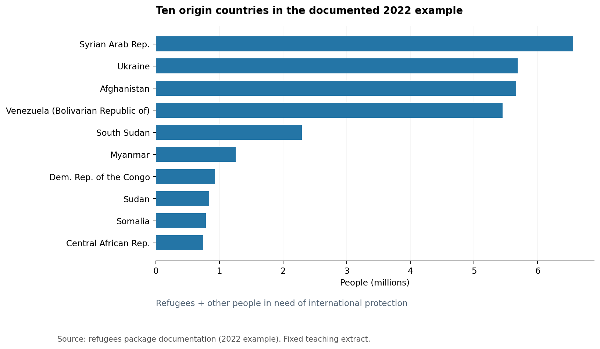
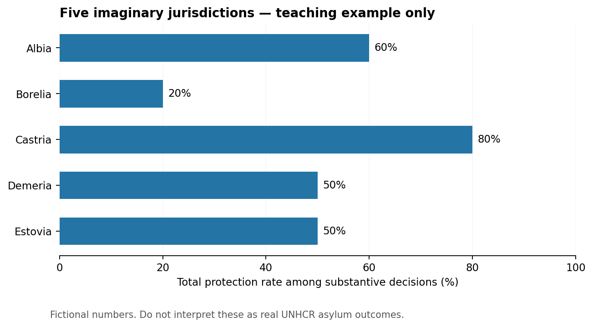

# Learning R with Refugee Data

A beginner-friendly **Quarto book** by Eréndira León-Salvador, Postdoctoral Research Fellow, ERC RefLex (*Is International Refugee Law Effective?*), UCD College of Social Sciences & Law. Contact: erendira.leonsalvador@ucd.ie.

This project teaches statistics and reproducible R workflows through UNHCR refugee data. It has numbered chapters, runnable R code chunks, outputs and figures generated during rendering, exercises and collapsible selected solutions.

## Quick start (RStudio)

1. Install **R** from https://cran.r-project.org/ and **RStudio Desktop** from https://posit.co/download/rstudio-desktop/.
2. Install **Quarto** from https://quarto.org/docs/get-started/ if RStudio does not already provide a functioning Quarto CLI.
3. In R's Console, run:

   ```r
   install.packages(c("refugees", "dplyr", "ggplot2", "readr", "tidyr", "scales", "knitr", "rmarkdown"))
   ```
4. Open `refugee-statistics-with-r.Rproj` in RStudio (or open the folder as a project).
5. Open an RStudio **Terminal**, then run:

   ```bash
   quarto preview
   ```

   This **executes the R chunks** and displays source code, tables and figures in a local browser. Use `quarto render` to build `docs/`.

If the first render fails at an `install.packages` error, install the package in the R console and rerun. If you see an error about missing `quarto`, install Quarto CLI and restart RStudio.

## Publish to GitHub Pages (recommended: GitHub Actions)

1. Create a new GitHub repository (for example `refugee-statistics-with-r`).
2. Add **all files**, including the hidden `.github/workflows/publish.yml` file and `data/` assets, then push them to the `main` branch.
3. On GitHub: **Settings → Pages → Build and deployment → Source: GitHub Actions**.
4. The provided workflow installs R and the book's packages, executes Quarto chunks to generate the plots, uploads `docs/`, and publishes the site on every push to `main`.
5. Follow the repository **Actions** tab to see whether the build passed. A Pages URL will appear after successful deployment.

The first build may need adjustment if an upstream dependency changes; the workflow has **not** been executed by this delivery environment.

## Why not simply publish the source `.qmd` files?

A `.qmd` file holds code and narrative, but an online reader needs a rendered HTML site to see the figures and printed R outputs. The workflow builds that HTML using R. GitHub Pages then serves only static HTML/CSS/JS—it does not run R for visitors.

## Dataset definitions and limitations

- The `data/unhcr_origin_top10_2022.csv` teaching file is a fixed transcription of 10 documented `refugees + oip` 2022 origin totals from the `refugees` package website: https://populationstatistics.github.io/refugees/.
- `data/toy_asylum_decisions.csv` is **fictional**, only for pedagogical calculations.
- Other figures are generated from the installed `refugees` R package when the site is rendered; revisions to source data can change results.
- Application and decision tables may mix reporting units (cases/persons) and procedural categories. Demonstrations involving unharmonized counts are clearly marked and should not be used as research estimates.

## Layout

- `_quarto.yml`: book chapter list, appearance, figure and publishing settings
- `index.qmd`: introduction and author biography
- `00-*.qmd` through `10-*.qmd`: teaching chapters
- `solutions.qmd`: selected collapsible worked solutions
- `glossary.qmd`: terminology
- `resources.qmd`: links and attribution
- `data/`: small reproducible local practice files
- `exercises/student-practice.R`: starter exercises
- `.github/workflows/publish.yml`: automated HTML build and Pages deployment

## Editorial note

The content is an original educational work. It draws inspiration from the teaching approach of *R for Data Science*, not its copyrighted prose or illustrations. This is not an official UNHCR data product or a UCD institutional statement.

## A preview of two figures

The figures below are **illustrative preview exports**, provided so that you can see the output style even before installing Quarto. In the published book, R code chunks generate their own charts from the underlying data.




